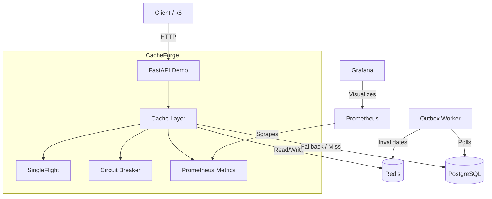

# CacheForge: Distributed Cache Layer

[](https://github.com/Olufemooshegs/cacheforge/actions/workflows/ci.yml)

A production-oriented, Redis-backed distributed caching layer for Python. CacheForge sits between FastAPI and PostgreSQL to reduce database load, lower latency, and survive cache outages without taking down the database.

**PostgreSQL is the source of truth. Redis is a performance layer.**

## 📊 Results (Real Benchmarks)

Using `k6` to simulate 50 concurrent users for 30 seconds, CacheForge demonstrates its impact under sustained load:

| Scenario | Throughput | Avg Latency | p95 Latency | DB Queries |
|---|---|---|---|---|
| **Baseline** (No Cache) | 258 req/s | 193 ms | 408 ms | ~7,700 |
| **CacheForge** (Hot Keys) | **798 req/s** | **62 ms** | **94 ms** | **~0** |

- **3.1× increase** in throughput.
- **4.3× improvement** in p95 tail latency.
- **Zero** database queries during the cached run.

*See [benchmarks/README.md](benchmarks/README.md) for full methodology, WSL2 caveats, and failure-injection results.*

---

## ✨ Features

- **Cache-Aside Reads**: Deterministic keys, namespacing, versioning, and configurable TTL with jitter.
- **Single-Flight Coalescing**: Protects the database from stampedes during cold starts.
- **Circuit Breaker**: Automatically short-circuits Redis calls after repeated failures.
- **Bounded Fallback**: If Redis dies, concurrent requests coalesce into *one* DB query, not thousands.
- **Transactional Outbox**: Guarantees cache invalidation even if Redis is down when a DB write commits.
- **Observability**: Built-in Prometheus metrics and provisioned Grafana dashboards.
- **Cache Warming**: Bounded, retried background worker to pre-populate hot data.

---

## 🏗️ Architecture



### Request Flow (Cache Miss)
1. App requests data from Cache.
2. Cache misses in Redis.
3. `SingleFlight` locks the key. One request queries Postgres.
4. Data is written to Redis.
5. All waiting requests receive the result.

---

## 🚀 Quick Start

Requires Docker and Python 3.12+.

```bash
# 1. Clone and configure
git clone https://github.com/Olufemooshegs/cacheforge.git
cd cacheforge
cp .env.example .env

# 2. Start infrastructure (Redis, Postgres, Prometheus, Grafana)
docker compose up -d

# 3. Set up Python environment
python3.12 -m venv .venv
source .venv/bin/activate
pip install -e ".[dev]"

# 4. Run database migrations and seed data
alembic upgrade head
python -m demo.seed

# 5. Start the API
python -m uvicorn demo.api:app --host 0.0.0.0 --port 8000
```

### Verify the Stack
```bash
# Terminal 2: Run the test suite
python -m pytest -q

# Hit the API
curl -s localhost:8000/products/1 | jq

# View the Grafana Dashboard
open http://localhost:3000
# View Prometheus Metrics
open http://localhost:9090
```

---

## 🛠️ API Endpoints

| Method | Path | Purpose |
|---|---|---|
| `GET` | `/products/{id}` | Fetch product (cache-aside) |
| `PATCH` | `/products/{id}` | Update + invalidate cache |
| `DELETE` | `/products/{id}` | Delete + invalidate cache |
| `POST` | `/admin/cache/warm` | Warm cache for top N products |
| `GET` | `/admin/cache/circuit-state` | Check breaker state |
| `GET` | `/admin/outbox/stats` | Check pending outbox events |

---

## 🧠 Design Decisions & Trade-offs

- **Eventual Consistency over Strong Consistency**: We use a transactional outbox and best-effort invalidation. There is a sub-second window where stale data can be served after a write. See [CONSISTENCY.md](CONSISTENCY.md) for the exact guarantees.
- **No Distributed Locks by Default**: Benchmarks proved per-process single-flight is sufficient. A distributed lock adds latency without meaningful DB savings. See [benchmarks/README.md](benchmarks/README.md).
- **Fail-Open, but Bounded**: If Redis dies, the app falls back to Postgres. However, we use a second `SingleFlight` for the fallback to prevent the cache outage from becoming a database outage.

---

## 📝 License
MIT
